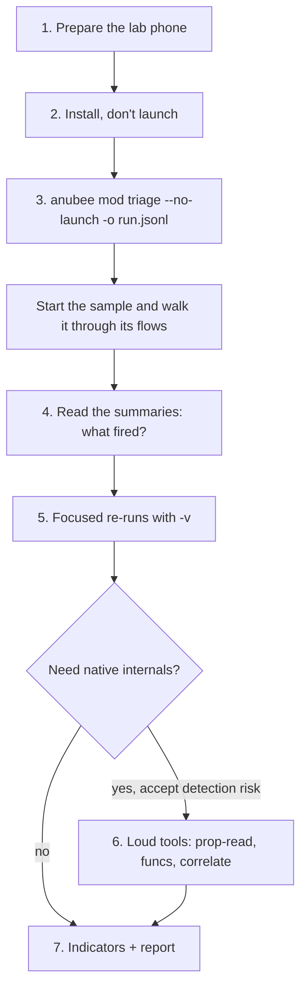

# Analysing an Android malware sample with `anubee mod`

A step-by-step workflow, from an unknown APK to a list of behaviours and
indicators. Everything in steps 2-4 is stealthy: kprobes and `/proc` reads
only, nothing written into the sample's memory, so anti-hooking checks have
nothing to find. Loud tools come last, and only by choice.



## 1. Prepare the lab phone

- A dedicated, rooted phone: no personal accounts, no SIM you care about,
  no other data. Take a full firmware backup before the first sample.
- Network: either isolated (a Wi-Fi network you control, ideally with
  traffic capture) or none. `net` reports hosts and byte counts either way;
  with no network, C2 connections still show as attempts (DNS lookups,
  connects that never send).
- Hide what samples look for, if you can do so without writing into them:
  root-manager apps, hooking frameworks and on-device scanners are all
  things malware checks for and reacts to (stays dormant, or uninstalls
  itself).
- Build and push `anubee` as in [`getting-started.md`](getting-started.md).

## 2. Install the sample without starting it

```sh
adb install sample.apk
PKG=$(aapt dump badging sample.apk | sed -n "s/package: name='\([^']*\)'.*/\1/p")
```

Don't open it yet: the first seconds of a run (unpacking, dropping, root and
emulator checks) are often the most telling, and `--no-launch` below makes
sure they are traced.

## 3. First run: `triage`

```sh
adb shell "su -c '/data/local/tmp/anubee mod triage -P $PKG --no-launch \
                  -o /data/local/tmp/run1.jsonl'"
```

`triage` starts every stealthy analyzer into one JSONL. With `--no-launch`
it traces the package's UID from the moment the app starts by any route.
Then, from another shell:

- start it from the launcher, or with
  `adb shell monkey -p $PKG -c android.intent.category.LAUNCHER 1`;
- if it has no launcher icon, start it the way it would start by itself, e.g.
  `adb shell su -c "am broadcast -a android.intent.action.BOOT_COMPLETED -p $PKG"`;
- walk through what it asks for: Accessibility, overlay ("display over
  other apps"), notification access, device admin, default-SMS role, screen
  capture. Many families do nothing interesting until they get one of these;
- leave it running for a few minutes (C2 check-ins, delayed payloads), then
  Ctrl-C. The summaries and a coverage record are written at the end.

Payload copies (dropped or in-memory DEX/APK/ELF, executable memory) are
saved next to the trace, in `run1.jsonl.payloads/`, each with its SHA-256.

## 4. Read what fired

Start with what's new. Much of a run is what every app does on start
(framework binder calls, the GPU driver probing its config, the permission
grants you gave). Trace a few ordinary apps once per device, exactly like
the samples, and build a noise profile from those runs; then a sample's run
reduces to the behaviour none of them showed:

```sh
python3 tools/anubee-mcp/mod_findings.py profile noise.json benign1.jsonl benign2.jsonl ...
python3 tools/anubee-mcp/mod_findings.py report noise.json sample.jsonl
```

Each finding has its count, seconds into the run, and failed outcomes
(`ENOENT x5` on a PATH search). Hidden records are counted, never dropped,
and record types the profile doesn't know are always shown. Build the
profile from benign apps only: malware families share tricks, and a profile
learned from them would hide those tricks. The same view is the
`mod_findings_view` MCP tool.

Then read the run view: the same run as one page, in time order, with
what the lab did (opening the sample, granting permissions) told apart
from what the sample did:

```sh
python3 tools/anubee-mcp/mod_findings.py report noise.json sample.jsonl --html sample.html \
        --marks sample.marks --meta meta.txt --badging badging.txt
```

All inputs after `--html` are optional. Marks (from `anubee mark`) are what
lets the page credit a permission change to the lab; without them every
change is shown as unattributed. Without `--marks`, a `sample.marks` next to
`sample.jsonl` is picked up (and named on stderr). `--badging` takes `aapt dump badging`
output (declared permissions that were never granted). `--apk` reads the
sample's entry list in memory to tell whether a payload came from inside the
APK; it never extracts anything. The page loads nothing from the network,
carries hashes and paths only (never payload files), and states the run's
limits (what the tracer can't see). Open it in a browser and copy the
indicators from its side panel.

Then read the detail:

Each analyzer prints a summary at the end, and writes the same summary to
the JSONL as a `*_summary` record. What each one means for a sample:

| Behaviour | Analyzer | Look for |
|---|---|---|
| Asks for / gets dangerous access | `perm-watch` | `granted` changes during the run: Accessibility, notification listener, device admin, SMS/home roles, `SYSTEM_ALERT_WINDOW` |
| Second stage (dropper, packer) | `dexload-detect` | `drop` → `load` → `delete` of a DEX/APK/ELF in the app's folder; `memload` = DEX loaded from memory. Saved copies → decompile them |
| Unpacked native code | `fileless-detect` | `mprotect_exec` (memory written then made executable) or `memfd_exec`; the region is saved |
| Accessibility abuse (banking trojans, RATs) | `accessibility-detect` | `screen_read` (reading other apps), `action` / `gesture` (clicking, typing), `global_action` |
| Screen streaming (RATs) | `screencapture-detect` | `projection_start` and `virtual_display` |
| Framework APIs it calls | `binder-api` | Package/app enumeration (`getInstalledPackages`, `getRunningAppProcesses`), `QUERY content://sms`, contacts, call log; settings reads (`android_id`) |
| C2 and data leaving | `net`, `exfil-detect` | `net_summary` destinations by bytes, TLS SNI / HTTP Host names, every name looked up; an `exfil-detect` alert = a sensitive file read followed by a large upload |
| File theft, ransomware | `file-access`, `massdelete-detect` | Opens of media / documents / other apps' folders; bursts of renames and deletes on shared storage |
| Anti-analysis | `file-access`, `execve` | `/proc` probes (`proc_self` maps / status = hook and debugger checks, `proc_system` net/tcp = Frida port scan, `proc_other_process` = process scanning); `execve` runs tagged `root` / `recon` (`which su`, `getprop`) |
| Commands it runs | `execve` | `tamper` (`pm install`, `settings put`, `setenforce`), `control` (`input`, `am`, `screencap`), `app_dir` (binary from its own folder), `memfd` |

Silence is only meaningful with full coverage: check each analyzer's
`[coverage]` line (or the `{"type":"coverage"}` records) for drops or blind
spots before concluding a behaviour is absent.

## 5. Focused re-runs

Rerun just the analyzers that fired, with `-v` for detail (e.g. `execve`
backtraces, own-folder opens in `file-access`):

```sh
adb shell "su -c '/data/local/tmp/anubee mod -m dexload-detect -m net -P $PKG -v \
                  -o /data/local/tmp/run2.jsonl'"
```

Decompile what `dexload-detect` saved (any DEX decompiler), and pull
unpacked native libraries with `anubee dump` (also stealthy: `/proc/<pid>/mem`
reads only) — see [`engines.md`](engines.md).

## 6. Loud tools, only when needed

`prop-read` (system-property checks: root, emulator, device fingerprint),
`funcs` and `correlate` place uprobes, which write a breakpoint into the
sample's memory. A sample that checks its own code integrity can see that.
Use them after the stealthy picture is complete, on a fresh install, and
treat a sample that changes behaviour under them as one that detected you.
`prop-read` can't see `Build.*` fields (they are filled before the app
starts); a sample reading `Build.MODEL` shows nothing there.

## 7. Indicators and report

From the JSONL (by hand with `jq`, or with the MCP server: `load_trace_structured`,
then `summaries()`, `mod_events(kind=...)`, `incidents()` — see [`mcp.md`](mcp.md)):

- **Network**: `net_summary.destinations` (IP:port, host, bytes) and
  `net_summary.lookups` (every name resolved).
- **Payloads**: SHA-256 of every saved copy (`dexload_detect` / `fileless_detect`
  records), and the path each was dropped at.
- **Access**: the `perm_change` timeline: what was granted, when.
- **Behaviour**: which analyzers fired, with the first event of each as
  evidence (`ts_ns` orders them across analyzers).

## What this won't show

Each analyzer's limits are listed in [`analyzers.md`](analyzers.md) and
DOCUMENTATION.md. The ones that matter most in practice: QUIC connections
have no host name; a payload deleted before anything maps it is reported but
not saved; file-existence checks (`stat`/`access`, e.g. looking for `su`)
aren't opens and aren't seen; a sample can throttle itself below the
`exfil-detect` and `massdelete-detect` thresholds.
